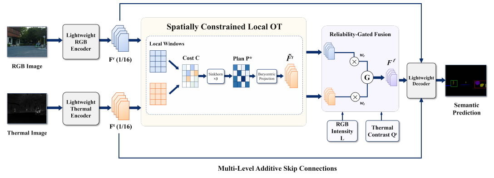
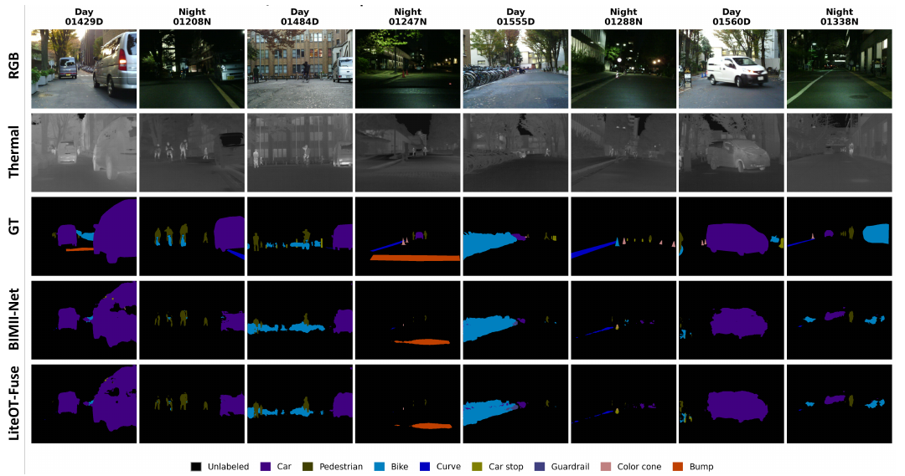

# LiteOT-Fuse

**Lightweight RGB–Thermal Semantic Segmentation via Spatially Constrained Local Optimal Transport**

LiteOT-Fuse is a compact RGB–thermal semantic segmentation model. It aligns nearby thermal and RGB features with spatially constrained local optimal transport, then uses a reliability gate to adjust their contributions as scene conditions change. The model combines asymmetric lightweight encoders, local OT at 1/16 resolution, and a lightweight decoder with multi-scale skip connections.



*Fig. 1. LiteOT-Fuse overview, reproduced from our ICESS 2026 submission.*

## Qualitative results



*Fig. 2. Daytime and nighttime examples on MFNet. Rows show RGB, thermal, ground truth, BIMII-Net, and LiteOT-Fuse; reproduced from our ICESS 2026 submission.*

## Main results

The table reports results from our paper on the MFNet test set. **Class Avg.** is mean precision over nine classes, including unlabeled. **MF-mIoU** follows the released MFNet evaluation protocol and differs from standard mIoU in its handling of unlabeled pixels. Day and Night are subset MF-mIoU. All values are percentages.

| Model | Parameters | Class Avg. | MF-mIoU | Day | Night |
| --- | ---: | ---: | ---: | ---: | ---: |
| MFNet | 736,275 | 63.55 | 64.91 | 61.08 | 61.89 |
| BIMII-Net | — | 63.61 | 64.21 | 59.13 | 62.03 |
| LiteOT-Fuse | 744,942 | **65.34** | **64.93** | 55.83 | **62.44** |

The complete model adds 8,667 parameters over MFNet. In the paper's batch-1 FP32 timing setup on an NVIDIA RTX PRO 6000 Blackwell Server Edition, it takes 3.829 ms per image (261.2 FPS). These numbers describe that server GPU setup, not embedded-device performance. The reported evaluation uses one training seed; daytime MF-mIoU is lower than MFNet's.

## Method

- **Local alignment:** A 4 × 4 window limits RGB–thermal correspondence to nearby features. Feature similarity and spatial distance form the transport cost; three Sinkhorn iterations produce a soft plan.
- **Reliability-gated fusion:** Semantic features, RGB intensity, and thermal contrast determine the modality weights. In the reported run, mean RGB gate weight changes from 53.4% by day to 42.9% at night.
- **Lightweight decoding:** Additive multi-scale skip connections preserve spatial detail without a heavy feature pyramid.

## Setup and data

Use Python 3.10 and install the CUDA-compatible PyTorch build for your machine. `environment.yml` lists the remaining environment dependencies. Download the [MFNet RGB–thermal dataset](https://www.mi.t.u-tokyo.ac.jp/static/projects/mil_multispectral/) and place it under `data/MF`, or pass its location with `--data-dir`. The dataset is not included in this repository.

```bash
conda env create -f environment.yml
conda activate SLOT
```

## Evaluate the released LiteOT-Fuse checkpoint

```bash
python evaluate.py \
  --model liteot \
  --data-dir data/MF \
  --weights weights/LiteOTFuse/full/best.pth \
  --output-dir results/liteot_full
```

`evaluate.py` reports the released-protocol and conventional segmentation metrics. To time the model in your environment:

```bash
python benchmark.py \
  --model liteot \
  --weights weights/LiteOTFuse/full/best.pth \
  --device cuda:0
```

## Train and reproduce

The following command matches the paper's 30-epoch setup and initializes the shared encoder from the MFNet checkpoint. The script has different defaults, so pass the paper settings explicitly.

```bash
python train_liteot.py \
  --model liteot --ablation full \
  --data-dir data/MF \
  --output-dir weights/LiteOTFuse/full \
  --init-mfnet weights/MFNet/final.pth \
  --epochs 30 --batch-size 6 \
  --learning-rate 0.001 --lr-decay 0.94 \
  --seed 1337
```

Ablation modes are `full`, `ot_only`, `gate_only`, and `backbone`. Checkpoint and experiment files are under `weights/` and `results/`; `LITEOT_REPORT_ZH.md` gives additional run details.

## Acknowledgments

This work builds on the [MFNet dataset and original implementation](https://www.mi.t.u-tokyo.ac.jp/static/projects/mil_multispectral/). The figures above come from our LiteOT-Fuse paper and show our method rather than the original MFNet README examples.
